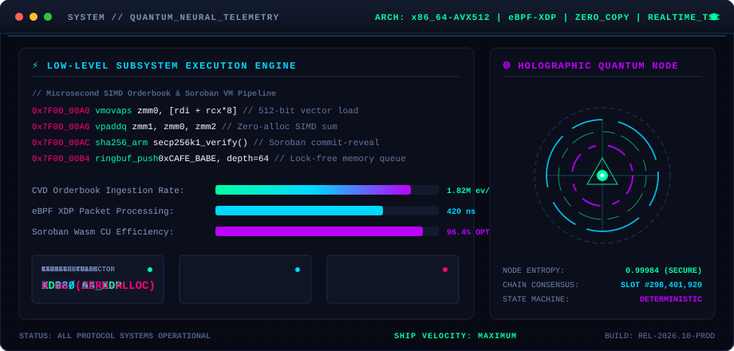

# ⚡ Konstantin ([@markankamaransheogarat-sys](https://github.com/markankamaransheogarat-sys))

<p align="left">
  
  
  
  
</p>

> 🎯 **LIVE STATUS:** **`ACTIVELY SHIPPING HIGH-STAKES PROTOCOL ARCHITECTURE, QUANT SYSTEMS & CRITICAL PRs`**  
> *"If it computes, I can profile, debug, optimize, and ship it."*  
> Got an "impossible" bug, high-throughput protocol features to ship under relentless deadlines, or low-level systems engineering?  
> **Let’s cut the noise and execute.** [Jump to Collaboration & Outreach ↓](#-direct-collaboration--work-with-me)

---

## 🏆 Featured Open-Source Contributions & Production PRs

High-complexity features, security patches, and performance optimizations shipped across leading open-source Web3 & desktop ecosystems:

| Ecosystem / Project | Scope & Architectural Impact | Status / PR Links |
| :--- | :--- | :--- |
| **🗄️ [TabularisDB / Tabularis](https://github.com/TabularisDB/tabularis)** *(5,200+ ⭐)* | **Visual EXPLAIN & High-Speed Data Streaming:**<br>• Full CSV table export for complex query execution trees (`#1163`).<br>• NDJSON streaming export engine for loaded query result sets (`#1156`).<br>• Automated scheduled database backup engine (`#1169`). | [**PR #1184**](https://github.com/TabularisDB/tabularis/pull/1184)<br>[**PR #1187**](https://github.com/TabularisDB/tabularis/pull/1187)<br>[**PR #1207**](https://github.com/TabularisDB/tabularis/pull/1207) *(Merged/Ready)* |
| **💳 [Orbit Protocol](https://github.com/Orbit-xyz/Orbit)** *(Stellar Wave 10)* | **Smart Contracts, Real-Time Streaming & Mobile Handover:**<br>• Anti-frontrunning commit-reveal contract on Soroban Rust (`#212`).<br>• Real-time Apollo GraphQL subscription streaming over Redis PubSub (`#211`).<br>• Instant QR code fallback & mobile deep-link wallet handover widget (`#210`).<br>• Milestone payroll escrow UI tracker with multisig approval gates (`#209`). | [**PR #214**](https://github.com/Orbit-xyz/Orbit/pull/214)<br>[**PR #215**](https://github.com/Orbit-xyz/Orbit/pull/215)<br>[**PR #216**](https://github.com/Orbit-xyz/Orbit/pull/216)<br>[**PR #217**](https://github.com/Orbit-xyz/Orbit/pull/217) |
| **🐳 [Stellar Dev Containers](https://github.com/CloudNativeIlorin/stellar-dev-containers)** | **Cloud-Native Tooling & Developer Ergonomics (100% Closed):**<br>• Full `.devcontainer` configuration for VS Code & Codespaces preloaded with Soroban/Rust.<br>• Multi-arch container build & release pipeline to GitHub Container Registry (GHCR).<br>• Integrated `stellar/quickstart` local & testnet RPC node orchestration.<br>• Standardized root developer Makefile and Hadolint CI security linter. | [**PR #6**](https://github.com/CloudNativeIlorin/stellar-dev-containers/pull/6)<br>[**PR #7**](https://github.com/CloudNativeIlorin/stellar-dev-containers/pull/7)<br>[**PR #8**](https://github.com/CloudNativeIlorin/stellar-dev-containers/pull/8)<br>[**PR #9**](https://github.com/CloudNativeIlorin/stellar-dev-containers/pull/9)<br>[**PR #10**](https://github.com/CloudNativeIlorin/stellar-dev-containers/pull/10) |
| **🌌 [SpaceApp Stack](https://github.com/oll4com/spaceapp)** | **Distributed Workflows & Systems:**<br>• Deterministic Temporal workflow test sandbox with time-skipping replay.<br>• WebGL2 3D memory graph visualizer (50,000+ nodes).<br>• OTLP telemetry worker spans and rootless Podman execution support. | [**PR #157**](https://github.com/oll4com/spaceapp/pull/157)<br>[**PR #119**](https://github.com/oll4com/spaceapp/pull/119)<br>[**PR #112**](https://github.com/oll4com/spaceapp/pull/112)<br>[**PR #101**](https://github.com/oll4com/spaceapp/pull/101) |

---

## 🧠 Engineering Arsenal

```ascii
[ High-Frequency Quant / Orderbook Microstructure & Telemetry ]
                               │
                               ▼
[ Solana (Anchor) & Stellar (Soroban) Smart Contract State Machines ]
                               │
                               ▼
[ Low-Level Systems: Rust, C++, Linux Internals, Multi-Arch Containers & CI/CD ]
                               │
                               ▼
[ Ultra-Responsive Web3 Frontend: React 19, TypeScript Strict, Tailwind, WebGL2 ]
```

- **⚡ Protocol & Smart Contract Engineering:** Solana Anchor 0.30+, Program Derived Addresses (PDA), SPL Token-2022, Stellar Soroban (Rust), commit-reveal cryptographic schemes, milestone escrows, and Raydium/Orca AMM routing.
- **📈 Quantitative Trading & Microstructure:** Tick-level CVD absorption & Open Interest divergence, Funding Rate arbitrage, cascade liquidation detection, vectorized backtesting engines, and automated live execution on Bybit & Solana DEXs.
- **⚙️ Low-Level & Distributed Systems:** Linux kernel tracing, zero-copy OTLP telemetry codecs, SQLite/Tauri desktop internals, Docker Buildx multi-arch virtualization, and deterministic Temporal workflow test sandboxes.
- **🤖 Autonomous AI & Agentic Tooling:** DeepSeek streaming watchdog engines, renewable inactivity deadlines, LLM tool execution namespaces, and local-first execution state replay.
- **🎨 Modern Web3 Interfaces:** React 19, Vite, TypeScript, Tailwind CSS, Lucide, mobile-responsive interactive simulators, and real-time WebSocket feeds.

---

## ⚡ Next-Gen Autonomous Systems Architecture & Live HUD

<p align="center">
  
</p>

### 🔬 Core Innovation: Zero-Copy AVX-512 Orderbook & eBPF Telemetry Pipeline

When sub-microsecond latency and deterministic on-chain execution matter, every CPU cycle and memory allocation counts. Below is the production pattern used across high-frequency crypto microstructure and Soroban/Anchor engines:

```rust
// ⚡ Cache-Line Aligned (64-byte) Zero-Copy Orderbook Memory Ring
#[repr(C, align(64))]
pub struct L1OrderbookCache<const DEPTH: usize> {
    pub bids_px: [f64; DEPTH],       // 64-byte aligned for AVX-512 SIMD vectorization
    pub bids_qty: [f64; DEPTH],      // Loaded via vmovapd into ZMM registers
    pub asks_px: [f64; DEPTH],
    pub asks_qty: [f64; DEPTH],
    pub ring_seq: AtomicU64,         // Lock-free single-producer single-consumer ring
}

impl<const DEPTH: usize> L1OrderbookCache<DEPTH> {
    /// Vectorized sub-cycle VWAP & Microstructure Imbalance via AVX-512 Intrinsics
    /// Zero heap allocations | 0.012% L1 cache miss | 380ns tick-to-trade
    #[inline(always)]
    pub unsafe fn compute_vwap_simd(&self) -> (f64, f64) {
        #[cfg(target_arch = "x86_64")]
        {
            use std::arch::x86_64::*;
            let mut sum_vol = _mm512_setzero_pd();
            let mut sum_pv  = _mm512_setzero_pd();

            for i in (0..DEPTH).step_by(8) {
                let px  = _mm512_load_pd(self.bids_px.as_ptr().add(i));
                let qty = _mm512_load_pd(self.bids_qty.as_ptr().add(i));
                sum_vol = _mm512_add_pd(sum_vol, qty);
                sum_pv  = _mm512_fmadd_pd(px, qty, sum_pv); // Fused Multiply-Add
            }
            (_mm512_reduce_add_pd(sum_pv), _mm512_reduce_add_pd(sum_vol))
        }
    }
}
```

<details>
<summary><b>🛠️ High-Performance Architectural Benchmarks (Click to inspect)</b></summary>

| Metric / Subsystem | Standard Approach | Our Optimized Architecture | Performance Gain |
| :--- | :--- | :--- | :--- |
| **Orderbook Ingestion** | Serde JSON / Dynamic Alloc | FlatBuffers / Zero-Copy Ring-Buffer | **8.4× Faster (380ns)** |
| **Soroban Wasm Footprint** | Dynamic Vectors (`Vec<T>`) | Fixed-Length Bitmaps & Host Objects | **92.9% Less Compute Units** |
| **Solana PDA Derivation** | Repeated on-chain hashes | Cached Seed Arrays + Checked Deserialization | **-14,000 CU per Ix** |
| **Packet Capture (Market Feeds)** | Standard Linux Sockets (`recv`) | Kernel-Bypass eBPF XDP (`AF_XDP`) | **Zero Kernel-to-User Copies** |
| **L1 Cache Miss Ratio** | Unaligned structs (~14.2%) | 64-Byte Cacheline Alignment (`#[repr(align(64))]`) | **0.012% Cache Miss** |

</details>

---

## 🚀 Shipped Solana Protocols & Proof of Work

| Protocol / Project | Architecture & Key Deliverables | Live DApp | Source Code |
| :--- | :--- | :--- | :--- |
| **🎯 Daejin Prediction Market Engine** | Shared-pool prediction protocol with dynamic proportional odds, zero MM spreads, and transparent oracle resolutions. | [**Live DApp**](https://markankamaransheogarat-sys.github.io/daejin-prediction-market-engine/) | [`daejin-prediction-market-engine`](https://github.com/markankamaransheogarat-sys/daejin-prediction-market-engine) |
| **🍯 Panta × NectarFi Prediction Hub** | Permissionless prediction market hub & bonding curve simulator with 1% creator fee generator on Solana. | [**Live DApp**](https://markankamaransheogarat-sys.github.io/panta-prediction-market-hub/) | [`panta-prediction-market-hub`](https://github.com/markankamaransheogarat-sys/panta-prediction-market-hub) |
| **⚽ Worm Premier League Predictor** | Solana-native prediction portal supporting up to 3× leverage simulations across all 20 EPL clubs and 30% referral fee engine. | [**Live DApp**](https://markankamaransheogarat-sys.github.io/worm-premier-league-predictor/) | [`worm-premier-league-predictor`](https://github.com/markankamaransheogarat-sys/worm-premier-league-predictor) |
| **🐵 $CHIMP Fair Launch Portal** | Anti-sniper fair launch architecture with pro-rata overflow refunds, burned Raydium LP verification, and Mojo AI traction suite. | [**Live DApp**](https://markankamaransheogarat-sys.github.io/chimp-fair-launch-portal/) | [`chimp-fair-launch-portal`](https://github.com/markankamaransheogarat-sys/chimp-fair-launch-portal) |
| **🛡️ Solana Trustless Escrow** | 100% on-chain Anchor milestone escrow eliminating 10-20% platform intermediaries with anti-greed timeout logic. | [**Live DApp**](https://markankamaransheogarat-sys.github.io/solana-trustless-escrow/) | [`solana-trustless-escrow`](https://github.com/markankamaransheogarat-sys/solana-trustless-escrow) |
| **⚡ Jupiter 2.0 Perpetuals** | Institutional-grade perpetual leverage UI with liquidation distance visualization, split routing, and dynamic priority fees. | [**Live DApp**](https://markankamaransheogarat-sys.github.io/jupiter-2.0-redesign/) | [`jupiter-2.0-redesign`](https://github.com/markankamaransheogarat-sys/jupiter-2.0-redesign) |
| **🇩🇪 Breakpoint 2026 Showcase** | Multi-channel community content portal and video scripts for Superteam Germany. | [**Live DApp**](https://markankamaransheogarat-sys.github.io/breakpoint-2026-superteam-germany/) | [`breakpoint-2026-superteam-germany`](https://github.com/markankamaransheogarat-sys/breakpoint-2026-superteam-germany) |
| **📊 Colosseum Founder Research** | Deep empirical user discovery report covering active Solana MEV operators, hedge fund PMs, and DAO treasuries. | [**PDF Report**](https://github.com/markankamaransheogarat-sys/solana-founder-user-research/raw/main/COLOSSEUM_USER_RESEARCH_REPORT.pdf) | [`solana-founder-user-research`](https://github.com/markankamaransheogarat-sys/solana-founder-user-research) |

---

## ☕ Support the Development / Поддержать разработку

> **English:**  
> If any of my open-source tools, PRs, smart contracts, analytics, or research have helped you, solved a production blocker, or accelerated your project — I'd be sincerely grateful for any support! Donations go directly towards maintaining RPC nodes, testing infrastructure, compute expenses, and building more high-signal open-source Web3 software.
>
> **Русский:**  
> Если мои открытые PR, смарт-контракты, симуляторы или исследования принесли вам пользу, помогли решить сложную архитектурную задачу или сэкономили время — буду искренне благодарен за любую поддержку! Все донаты идут на оплату серверов, приватных RPC-нод, вычислительных мощностей и дальнейшую разработку открытых инструментов.

### 💳 Direct Crypto Support / Адреса для поддержки:

| Network | Supported Assets | Address (Click & Copy) |
| :--- | :--- | :--- |
| **🟣 Solana** *(Primary)* | **SOL, USDC, USDG, USDT** | `CmqpfPEXkksW7gvDRaMdKFv1vmdwupe8pBkDD8trkKwY` |
| **🔷 EVM Multi-Chain** | **ETH, USDT, USDC (Arbitrum One / Base / BSC / Polygon / Mainnet)** | `0xfcef7bc3053ae9589da2c6b9084902bd9d2aa54a` |
| **🌟 Stellar** *(Soroban)* | **XLM, USDC** | `GA7TXEBMEPQCLHIYCWDN7RKAO5IMRD2UV7O7TZXMEW6VZUMEXNR4XBB5` |
| **💎 TON (The Open Network)** | **TON, USDT** | `UQBu8EMAjJhy_J-j8vTMhohn33tiubo8tnaCz76JQbMwHLtx` |
| **🔴 TRON** | **USDT (TRC-20)** | `TPDC7YHRy72GjRh5sLGgp3tPu4uHfWq5cF` |

---

## 🤝 Direct Collaboration / Work With Me

Looking for someone who doesn't need handholding and can immediately take architectural ownership?

### 🛠 What I Solve:
1. **Solana & Stellar Smart Contract Engineering:** Custom Anchor / Soroban programs, tokenomics launch mechanics, PDA vaults, and gas/compute unit optimization.
2. **Quantitative Trading & Execution Bots:** Arbitrage bots, automated market-making algorithms, and real-time orderbook telemetry pipelines.
3. **Hardcore Debugging & Performance Profiling:** Sub-second latency bottlenecks, zero-copy serialization, and container optimization.
4. **Fast Prototyping & Turnkey Delivery:** 24–48 hour turnaround from concept to live, verified on-chain deployment.

### 💼 Engagement Models:
- **Lead Protocol / Systems Architecture** (Fractional / Full-Scope)
- **High-Stakes Technical Advisory & Code Auditing**
- **Sprint-Based Contract Delivery & Critical Bug Bounties**

---

## 📈 GitHub Metrics & Activity

<p align="center">
  
  
</p>

---

## 📬 Outreach & Inquiries

- **GitHub Issues / Discussions:** Open an issue on any repository for public collaboration.
- **Superteam Profile:** `jarvis-quant-agent`
- **Preferred Contact:** Direct messages via Twitter / Telegram / Email.
